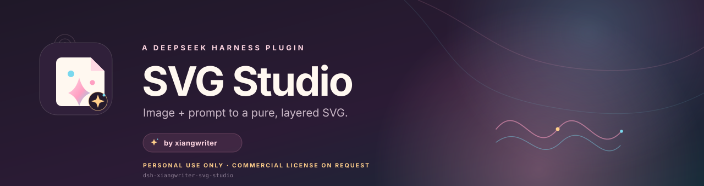

<p align="center">
  
</p>

<p align="center">
  <a href="https://github.com/xiangwriter-dev/dsh-xiangwriter-svg-studio/actions/workflows/ci.yml"></a>
  <a href="LICENSE"></a>
  
  
  
  
</p>

<h1 align="center">SVG Studio</h1>

<p align="center">
  Image + prompt → pure, layered SVG.<br>
  A local-first vectorization studio for DeepSeek Harness.<br>
  <sub>Built and maintained by <a href="https://github.com/xiangwriter-dev"><strong>xiangwriter</strong></a>.</sub>
</p>

<p align="center">
  <code>dsh-xiangwriter-svg-studio</code>
</p>

<p align="center">
  <a href="README.zh-CN.md">简体中文</a> ·
  <a href="#install">Install</a> ·
  <a href="#use-it">Usage</a> ·
  <a href="#how-the-engine-works">Engine</a> ·
  <a href="#development">Development</a> ·
  <a href="#license">License</a>
</p>

> **Personal, non-commercial use only.**
> This repository is source-available, not open-source. Commercial use of any kind
> requires a separate written licence from xiangwriter; see [COMMERCIAL.md](COMMERCIAL.md).
> The `xiangwriter` name, mark and branding must remain intact.

---

SVG Studio turns a character illustration, sticker or flat-colour image into a **real SVG made of paths, gradients and masks** — no embedded bitmap, no external tracing service. It ships as three things in one DeepSeek Harness plugin:

- a full **Web Studio** page in the Harness sidebar,
- an agent tool, **`svg_studio`**, for file-path workflows,
- a reusable agent skill, **`svg-vector-recreation`**.

Everything runs locally. Images and prompts go only to the local Harness server and the local Python engine.

## Why it exists

Most image-to-SVG tools either return one giant traced path, or quietly embed the source PNG inside an SVG. SVG Studio is built for character art: it keeps the figure, refines the face locally, builds a clean backdrop, and validates that the result is genuinely vector.

The original illustration is never included in this repository; the plugin contains code and synthetic test fixtures only.

## Highlights

- **Prompt-guided presets.** Write what you want in natural language (“keep the wine-red backdrop, clean up the contour, more detail in the eyes”) and the engine maps those notes to colour counts, face detail and backdrop settings. Explicit overrides always win.
- **Layered colour tracing.** Median-cut palette → connected colour regions → closed contours with even-odd holes → optional RDP simplification. A single colour can contain many islands.
- **A figure-aware clip.** The engine samples the backdrop, separates it from the figure, handles interior holes and near-white areas, then pre-clips colour paths to the character. Background noise and stray colour blobs are less likely to become paths.
- **Local face-detail pass.** A small, soft-masked palette refines eyes, cheeks, mouth and hair details without changing the rest of the image.
- **Clean backdrops without invented effects.** The default `gradient` backdrop is a clean gradient derived from the source border. It does **not** add a synthetic halo or dark ring. Choose `original` to keep the source background.
- **Outline is opt-in.** The extra dark outer contour is **off by default**. Turn it on in Advanced settings only when you want a sticker-like rim.
- **Small, inspectable output.** Paths, gradients, a soft face mask, and no `<image>` or `data:image` payloads. A structural check rejects malformed SVG.
- **Bounded work.** Long edges above 1200 px are scaled down; the engine warns when an output gets large. Typical 240 px chibi art completes in under two seconds.
- **English and Chinese UI**, with locale files you can extend.

## Install

Requires a DeepSeek Harness profile with the Web UI and a Python 3.10+ interpreter with **Pillow** and **numpy**.

1. Install the plugin from GitHub:

   ```bash
   dsh plugin add github:xiangwriter-dev/dsh-xiangwriter-svg-studio
   ```

   Or from a local checkout:

   ```bash
   dsh plugin add /absolute/path/to/dsh-xiangwriter-svg-studio
   ```

2. Install the Python engine dependencies into the interpreter DSH can see:

   ```bash
   python -m pip install -r engine/requirements.txt
   ```

   On Windows, DSH also detects its bundled Python runtime and `DSH_SVG_STUDIO_PYTHON` if set. The Studio page shows **Local engine ready** when Pillow and numpy are available.

3. Refresh the Harness Web UI. The sidebar entry **SVG Studio / SVG 矢量化** opens the Studio.

The plugin is a bundle with a Host half (`index.js`), a Web client (`client.js`), a Cordis patch, locale metadata and the Python engine.

## Use it

### In the Web Studio

1. Drop a PNG, JPG, WebP or GIF, or click to choose one. Images are normalised to a maximum 1200 px long edge and flattened onto white before upload.
2. Optional: write a short direction in **Your ideas and direction**.
3. Pick a preset (or open **Advanced settings**).
4. Press **Generate SVG**. Preview, download, copy the code, or open the SVG in a new tab.

### From an agent

Ask in natural language; the skill is selected automatically when the task matches it:

```text
Use svg_studio on D:\art\character.png. Preset: faithful. Keep face detail on,
outer contour off, clean gradient background. Save the SVG next to the source.
```

Or call the tool directly. Common arguments:

| Argument | Values | Notes |
| --- | --- | --- |
| `image_path` | local path | PNG / JPEG / WebP / GIF |
| `prompt` | free text | Stored in the SVG description; guides settings |
| `preset` | `faithful`, `clean`, `flat`, `original`, `mini` | Defaults to `faithful` |
| `colors` | 24–224 | Overrides the preset palette size |
| `face_detail` | boolean | Local face pass |
| `outline` | boolean | Extra outer rim, off by default |
| `background` | `auto`, `gradient`, `original` | Clean gradient, auto, or source backdrop |
| `saturation`, `contrast` | numbers | Small colour adjustments |
| `output_path` | local path | Optional destination for the `.svg` |

### Presets

| Preset | Palette | Face pass | Backdrop | Best for |
| --- | ---: | :---: | --- | --- |
| `faithful` | 160 | on | clean gradient | closest overall recreation |
| `clean` | 112 | on | clean gradient | smaller, flatter, tidier files |
| `flat` | 72 | off | clean gradient | poster-like colour masses |
| `original` | 140 | on | source backdrop | scenes, photos, or when the backdrop is part of the art |
| `mini` | 64 | off | clean gradient | very simple art and tiny files |

The outer contour is independent of the preset and is **off by default**.

## Output contract

- The SVG contains `<path>`, `<linearGradient>`, `<radialGradient>`, `<ellipse>`, `<mask>` and a `<clipPath>` — no raster image.
- The output is XML-validated; `<image>`, `data:image`, and base64 payloads are rejected.
- Generated files are stored under `$DSH_HOME/svg-studio/outputs/` and pruned to the newest 40.
- The result is a local file; nothing is uploaded to a cloud service.

## Local API

The Studio talks to three exact, local-only routes served by the Host plugin:

| Method | Route | Purpose |
| --- | --- | --- |
| `GET` | `/svg-studio/api/health` | Python, Pillow and numpy availability |
| `POST` | `/svg-studio/api/generate` | data-URL or file-path generation |
| `GET` | `/svg-studio/file?name=<name>.svg` | serve a saved output from the output directory |

These routes are registered on the local Harness web server and are not intended to be exposed publicly.

## How the engine works

```text
source image
   │  normalize / flatten
   ▼
adaptive palette (median cut)
   ▼
colour-family masks → connected components → closed contours with holes
   ▼
figure silhouette (border background + component cleanup + hole handling)
   ▼
pre-clip colour paths to figure · local face-detail palette in a soft mask
   ▼
clean backdrop gradient (no synthetic halo) · optional outer contour
   ▼
closed-contour RDP simplification · XML and purity validation
   ▼
.svg
```

Key behaviours fixed in this release:

- Light and neutral backgrounds use a border-connected background component, so near-white skin, dress panels and highlights stay in the figure.
- Clean backdrop mode does not manufacture a dark halo. Any visible backdrop accent comes from the source, or from the `original` background mode.
- The outer contour is off by default. Prompts such as “clean up the contour” no longer switch it on accidentally; only an explicit outline request or the Advanced toggle does.
- The face-detail layer is traced without RDP so facial details do not turn into speckles.

## Requirements and limits

- **DeepSeek Harness** with the Web UI / sidebar slots and `ctx.webServer`, `ctx.tools`, `ctx.skills`.
- **Node.js 20+** (supplied by the harness).
- **Python 3.10+**, **Pillow ≥ 10**, **numpy ≥ 1.26**.
- Input: PNG, JPEG, WebP or GIF. Transparent export and SVG-to-SVG editing are not part of this version.
- The interactive page normalises images to a 1200 px long edge (and a 26 MB client-side cap) to keep generation fast. The tool uses the same long-edge cap.
- Very large or noisy images may produce large SVGs; the engine reports a warning when the output crosses 10 MB.
- The local API has no authentication of its own; it relies on the harness web server being local/private.

## Development

```text
dsh-xiangwriter-svg-studio/
├─ index.js                  Host half: skill, tool, HTTP routes, Python detection
├─ client.js                 Web Studio page + sidebar icon (module id: dsh-xiangwriter-svg-studio)
├─ engine/svg_engine.py      Pillow + numpy vector engine
├─ engine/requirements.txt   Python dependencies
├─ skill.md                  Agent workflow and quality gates
├─ locale/                   en / zh metadata and UI dictionaries
├─ cordis.patch.yml          Bundle patch (row id: svg-studio)
├─ icon.svg                  Plugin mark with the xiangwriter seal
├─ assets/                   README banner and xiangwriter mark
├─ tests/smoke_engine.py     Synthetic end-to-end engine smoke test
└─ .github/workflows/ci.yml  JS/Python checks and smoke test
```

```bash
# JS syntax
node --check index.js
node --check client.js

# Python environment and smoke test (no Chrome needed)
python -m pip install -r engine/requirements.txt
python -m py_compile engine/svg_engine.py
python tests/smoke_engine.py
```

The smoke test creates its own synthetic flat-colour image, runs the engine, and asserts that the result is pure SVG, has no `haloGrad`, has no `outer-outline`, and is structurally valid. It does not use any third-party artwork.

## License

**Personal, non-commercial use only.** This is a source-available, proprietary
licence, not an OSI open-source licence.

- Personal use is allowed under the terms in [LICENSE](LICENSE).
- Commercial use requires a separate written licence; see [COMMERCIAL.md](COMMERCIAL.md).
- Contact: [xiangwriter-dev on GitHub](https://github.com/xiangwriter-dev) or open a
  [Commercial license request](https://github.com/xiangwriter-dev/dsh-xiangwriter-svg-studio/issues/new?title=Commercial%20license%20request).
- The `xiangwriter` name and mark identify the author and must remain intact.
- Source illustrations you process remain yours and are never committed here.

© 2026 xiangwriter. All rights reserved.
